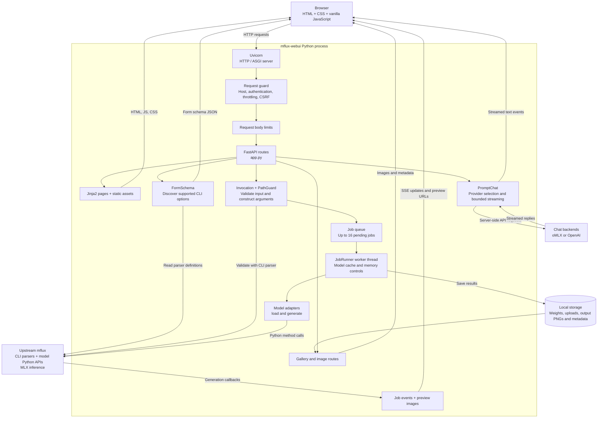
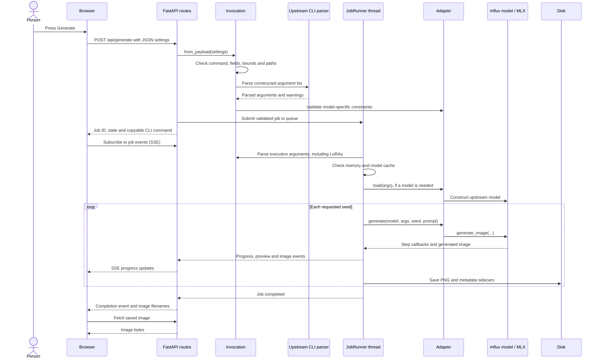

# Architecture

`mflux-webui` runs one Python server process. The browser sends JSON requests to
FastAPI, and a dedicated worker thread calls upstream mflux to generate images.
The UI package lives under `mflux.web.x746b_ui`; the inference implementation comes
from the separately installed `mflux` dependency.

## The short version

1. **Choose settings in the browser.** The form follows the options of supported mflux commands.
2. **Send a generation request.** The local server checks it and adds it to the job queue.
3. **Generate on the Mac.** A background worker calls mflux's Python API and streams progress back.
4. **Keep the result.** The image and its settings are saved locally for the gallery to display and reuse.

Prompt chat is optional and runs alongside this flow. It helps write the prompt;
the image itself is generated by mflux. The copyable CLI command describes the
same generation settings.

## Components

Arrows summarize logical data flow. Browser-facing responses still travel through
the HTTP server and applicable middleware. Local model and LoRA paths are checked
against configured roots before use.

## Frontend and request handling

Jinja2 renders the page structure from fixed templates. JavaScript provides the
interactive behavior:

| File | Responsibility |
| --- | --- |
| `static/generate.js` | Build forms, collect settings, submit jobs, display progress and results |
| `static/gallery.js` | List images, inspect metadata, restore settings and delete results |
| `static/settings.js` | Appearance, assistant preferences and server configuration status |
| `static/chat.js` | Prompt conversations, provider switching and explicit prompt insertion |
| `static/common.js` | HTTP helpers, session/CSRF handling, streaming and worker-status polling |

Requests pass through the Web UI request guard, then body-size enforcement, and
reach the matching FastAPI route. The guard applies host restrictions,
authentication where configured, authentication throttling, and CSRF checks for
state-changing requests. Responses receive security and cache-control headers.

Routes are registered directly on one FastAPI application in
[`app.py`](../src/mflux/web/x746b_ui/app.py). The `_register_*` methods group related
routes; there are no separate `APIRouter` objects in the current implementation.

| Routes | Purpose |
| --- | --- |
| `/`, `/gallery`, `/settings` | HTML pages |
| `/static/*` | JavaScript, CSS and other static assets |
| `/api/session`, `/api/login`, `/api/logout`, `/api/setup` | Session and authentication handling |
| `/api/commands`, `/api/commands/progress` | Form definitions and startup discovery progress |
| `/api/validate`, `/api/generate` | Validate settings or queue generation |
| `/api/uploads` | Validate and re-encode reference/init images |
| `/api/jobs/*`, `/api/status` | Job state, events, previews, cancellation and worker status |
| `/api/gallery`, `/api/images/*` | Saved images and metadata |
| `/api/chat/config`, `/api/chat` | Assistant configuration status and streamed replies |

## Startup: how the form is built

1. The browser loads the Generate page and its JavaScript. Controls stay disabled
   while the loading indicator is visible.
2. JavaScript requests `/api/commands` and polls `/api/commands/progress`.
3. [`FormSchema`](../src/mflux/web/x746b_ui/schema.py) iterates the supported
   adapters and asks upstream `mflux.cli.capabilities.describe_command` for each
   CLI parser's options, defaults, choices and conditions.
4. The UI filters out unsupported or server-owned options, groups the remaining
   fields, and discovers local model/LoRA files.
5. JavaScript renders the form from that JSON and restores saved browser settings.

The adapter registry determines which commands are supported. Parser introspection
keeps their exposed options aligned with core; it does not automatically add
support for every new upstream command. Schemas are cached in memory. The first
discovery can be slower because CLI modules import their dependencies.

## Generate: from a form to Python execution

[`Invocation`](../src/mflux/web/x746b_ui/invocation.py) translates JSON into an
argument list such as `--prompt=...`, `--width=...`, and `--model=...`. It uses the
same upstream `build_parser().parse_args()` interface as the CLI. Parsing is
serialized because the CLI parser reads process-wide `sys.argv`; the previous
state is restored afterward. Initial validation leaves out LoRA resolution to
avoid downloading weights before a job runs.

[`JobRunner`](../src/mflux/web/x746b_ui/runner.py) executes queued jobs one at a time
on a dedicated thread. It loads or reuses a model, applies memory controls,
generates each seed, saves results, and handles cancellation at generation
checkpoints. With `--cache-size 0`, the model is released after the job.

[`adapters.py`](../src/mflux/web/x746b_ui/adapters.py) bridges each supported command
to its upstream model class. Its `load()` and `generate()` methods mirror the
relevant CLI orchestration and call the model's Python API directly. Generation
does not launch an `mflux-generate-*` shell process.

The displayed shell command is produced separately by `Invocation.shell_command()`
using `shlex.join()`. It represents the job's settings for copying into a terminal.
`/api/validate` can return that command without starting generation.

## Results and prompt assistance

The worker emits in-memory job events. The browser receives those through
Server-Sent Events, fetching preview JPEGs and completed PNGs through separate
endpoints. Each saved image has core metadata and a `.web.json` sidecar containing
the UI settings needed for gallery reuse. Job history is in memory; saved images
and their sidecars remain on disk.

Prompt assistance is a separate path through `/api/chat`. The server selects
OpenAI Responses or oMLX Chat Completions, supplies the appropriate environment
credential, and normalizes provider streaming into newline-delimited JSON events
for the browser. This is separate from the SSE stream used for image-generation
jobs. Provider conversations remain separate, and inserting a suggested prompt
requires an explicit action in the browser.

The installed application runs from its `uv tool` environment. The Git checkout
is the source repository and is not needed for a normal installed launch.
